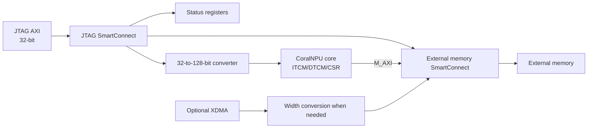

# CoralNPU on BittWare XUP-VVP

Custom shell for CoralNPU with the BittWare XUP-VVP/CVP-13.
This branch includes DIMM0 DDR4 support, pending testing with installed DIMMs.

<details>
<summary><strong>Architecture overview</strong></summary>

Bazel exports the chosen core and board sources to FuseSoC, then uses Vivado.
The shell provides JTAG AXI access, XDMA, and external memory.



SmartConnect connects the core, JTAG, and XDMA to external memory.
The JTAG host can also access status registers and the core's AXI slave.
All memory addresses are global.

The DDR4 MIG has its own UI clock domain, bridged to the fabric by an AXI
clock converter. Calibration status is synchronized into fabric readiness.

### AXI widths and address limits

The core external AXI master is 128-bit data, 32-bit byte address, with six-bit transaction IDs.
JTAG AXI is 32-bit data and uses a width converter to access the core's internal AXI slave.
The JTAG loader splits memory transfers at 256 32-bit words, 4 KiB boundaries,
and memory-region ends. Its CSR path disables width converter packing and
writes each aligned 32-bit register separately.

</details>

## Requirements

- Bazelisk or Bazel 9.1.0
- CoralNPU source checkout at `../coralnpu` (tested against `15573b6929f587fa3ef51b4e4cc2017c850f7e3b`)
- Vivado 2025.2
- JTAG via Vivado hardware server
- [XDMA reference driver](https://github.com/Xilinx/dma_ip_drivers)

## Build

The default build is RVV, Gen2 x4 PCIe, BRAM, and the release profile:

```sh
bazel build //:build_bitstream
```

Save the routed checkpoint for future incremental builds:

```sh
bazel run //:save_checkpoint
```

For example, build a VME image with no PCIe endpoint:

```sh
bazel build //:build_bitstream --config=vme --config=jtag
bazel run //:save_checkpoint
```

Available build settings are

| Setting | Values | Default |
| --- | --- | --- |
| `--//:core` | `scalar`, `rvv`, `vme` | `rvv` |
| `--//:pcie` | `none`, `gen2x4`, `gen3x16` | `gen2x4` |
| `--//:ext_mem` | `bram`, `uram`, `dram` | `bram` |
| `--//:profile` | `debug`, `release` | `release` |
| `--//:incremental` | `true`, `false` | `true` |

Presets in [`.bazelrc`](.bazelrc) include `scalar`, `rvv`, `vme`, `jtag`, `debug`,
`release`, and `dram`. The `ddr` preset aliases `dram`, and `vme-ddr` selects
VME, DRAM and Gen2 x4 PCIe.

<details>
<summary><strong>Build stages</strong></summary>

| Target | Result |
| --- | --- |
| `//:memory_map` | Generate memory map Tcl and SystemVerilog constants |
| `//:build_elab` | Create the project and elaborate RTL/block design |
| `//:build_synth` | Synthesize and expose synthesis checkpoint |
| `//:build_bitstream` | From synthesized checkpoint, implement design, run build checks, and produce bitstream |

</details>

<details>
<summary><strong>Build outputs</strong></summary>

The bitstream build exposes `xup_coral.bit`, `xup_coral.ltx`,
`xup_coral_routed.dcp`, reports, and the Vivado project in Bazel output groups.

Incremental implementation uses the saved reference in
`build/incremental/{scalar,rvv,vme}/latest.dcp`.
Save a new checkpoint with `bazel run //:save_checkpoint`.

</details>

<details>
<summary><strong>Core variants</strong></summary>

| Core | RTL module | Fabric clock | Feature register bit |
| --- | --- | --- | --- |
| `scalar` | `CoreMiniAxi` | 60 MHz | 0 |
| `rvv` | `RvvCoreMiniAxi` | 50 MHz | 1 |
| `vme` | `VmeCoreMiniAxi` | 30 MHz | 2 |

RVV and VME use VLEN 128

</details>

## Memory map

[`config/memory_map.yaml`](config/memory_map.yaml) generates
address constants used by RTL, Tcl, and the generated firmware linker script.
The defaults are:

| Region | Base | Default size | Access/use |
| --- | --- | --- | --- |
| ITCM | `0x00000000` | 8 KiB | Loadable and executable firmware |
| DTCM | `0x00010000` | 32 KiB | Loadable data and stack |
| Core CSR | `0x00030000` | 4 KiB | Core control and status registers |
| Shell registers | `0x40000000` | 64 KiB | Read-only board status |
| External memory | `0x80000000` | 256 KiB | Loadable data for the selected backend |

<details>
<summary><strong>External memory backend</strong></summary>

The default external window ends at `0x8003ffff`, configurable with `external.size`.
The largest contiguous window addressable by the core is 2 GiB.

Only one backend is selected per build. The on-chip backends require a
4 KiB-aligned base and a capacity divisible by 4 KiB.

The DRAM backend uses one MIG-backed window with clock and width conversion.
`external.size` controls its mapped aperture, without changing MIG geometry.

</details>

<details>
<summary><strong>Core CSR registers</strong></summary>

Offsets relative to `0x00030000`:

| Offset | Register | Definition |
| --- | --- | --- |
| `0x00` | Control | Bit 0 asserts reset, bit 1 gates the core clock. Reset value is `3` |
| `0x04` | Start PC | Entry point used when starting the core |
| `0x08` | Status | Bit 0 indicates halted; bit 1 indicates fatal fault |

The loader writes complete aligned 32-bit CSR words. It loads with control
`3`, writes the start PC, then writes control `1` to ungate the clock while
reset is asserted, followed by control `0` to release reset.

</details>

<details>
<summary><strong>Shell status registers</strong></summary>

Offsets relative to `0x40000000`:

| Offset | Register | Definition |
| --- | --- | --- |
| `0x0c` | Heartbeat | Fabric-clock counter |
| `0x10` | Readiness | Bit 0: fabric reset released. Bit 1: external memory ready |
| `0x18` | Features | Core feature bits listed above |
| `0x1c` | Fault | Core fatal-fault signal |

Readiness value `3` means the fabric reset is released and external memory is ready.
For DRAM, memory readiness includes MIG calibration.
The loader waits up to 30 seconds for readiness `3` before loading.
The `status` command can inspect status before readiness
reaches `3`, and `stop` can assert reset without waiting for memory.

</details>

## PCIe and XDMA

XDMA exposes the external memory window via one H2C and one C2H channel.

| Setting | Link | XDMA AXI interface | Remarks |
| --- | --- | --- | --- |
| `none` | None | None | Select with `--config=jtag` |
| `gen2x4` | 5.0 GT/s, 4 lanes | 128 bits @ 125 MHz | Default |
| `gen3x16` | 8.0 GT/s, 16 lanes | 512 bits @ 250 MHz, converted to core 128-bit fabric | Fails to route with VME |

Wait for readiness `3` before accessing external memory. Transfers can be done via

```sh
dma_to_device -d /dev/xdma0_h2c_0 -f input.bin -a 0x80000000 -s 1024
dma_from_device -d /dev/xdma0_c2h_0 -f output.bin -a 0x80000000 -s 1024
```

PCIe builds replicate the PHY's final reset distribution register before routing to improve WNS.

</details>

## DIMM0 setup

Select the DIMM backend with `--//:ext_mem=dram` or `--config=dram`. The
included profile in [`config/dimm0_mig.tcl`](config/dimm0_mig.tcl) and
[`config/dimm_parts/BLS4G4D240FSB.csv`](config/dimm_parts/BLS4G4D240FSB.csv)
describes a one-rank, 64-bit `BLS4G4D240FSB-2400` UDIMM. It is an example
profile: the installed DIMM must match its geometry and timing, or the profile
and MIG settings must be updated. The build configures the selected profile;
it does not identify the installed module automatically.

<details>
<summary><strong>DIMM bring-up</strong></summary>

The memory map exposes a 256 KiB window by default; this is the mapped aperture,
not the full capacity described by the DIMM profile. `external.size` controls
that aperture.

Before using a DIMM image:

1. Verify the installed DIMM part and geometry against the MIG profile.
2. Build and program an image configured for `dram`.
3. Run `bazel run //:status` and confirm readiness is `3` before loading
   firmware or issuing PCIe DMA to external memory.
4. If readiness remains `1`, the fabric reset is released but external memory
   is not ready; wait for calibration or diagnose the DIMM configuration.

</details>

## JTAG and FPGA programming

Configure [`config/hardware.yaml`](config/hardware.yaml), then program a bitstream with:

```sh
bazel run //:program -- "$(realpath bazel-bin/build_bitstream/xup_coral.bit)"
```

The programmer uses a sibling `.ltx` file when available.

If XDMA is enabled, stop all host DMA clients before programming.
The programmer removes the configured PCIe endpoint before programming
and rescans the PCI bus after.

## Firmware build

`integration/firmware.bzl` provides the linker `xup_firmware_binary`, which
links the upstream CoralNPU CRT and generates a linker script from the memory map.

The linker reserves a stack in DTCM (default 2 KiB) and maps external
data sections into the configured external window.

The loader stores file-backed segments in a binary payload and clears BSS in
bounded chunks, verifying each transfer by readback.

Add the application source and target to `firmware/`. For example:

```c
int main(void) {
    return 0;
}
```

```starlark
load("//integration:firmware.bzl", "xup_firmware_binary")

package(default_visibility = ["//visibility:public"])

xup_firmware_binary(
    name = "app",
    core = "rvv",
    srcs = ["main.c"],
    stack_size_bytes = 2048,
    copts = ["-Os", "-ffunction-sections", "-fdata-sections"],
)
```

<details>
<summary><strong>Firmware target</strong></summary>

`core` attribute selects the firmware ISA and must be aligned with the FPGA.

| Firmware core | Source compilation ISA |
| --- | --- |
| `scalar` | `rv32im_zicsr_zifencei` |
| `rvv`/`vme` | `rv32imf_zve32f_zicsr_zifencei_zbb_zfbfmin_zvfbfmin_zvfbfwma` |

The ABI is `ilp32`. The DTTM stack size must be a multiple of 16 bytes.
The linker generator requires ITCM to begin at address zero, retains and sorts
constructor/destructor entries, and aligns the BSS end for the CRT's word-based
clearing routine.

</details>

## Executing firmware

The macro exposes `bazel-bin/firmware/app.elf` and `app.bin`.
Build and load the ELF after programming a compatible FPGA image:

```sh
firmware_target=//firmware:app.elf
bazel build "$firmware_target"
firmware_elf=$(bazel cquery "$firmware_target" --output=files)
bazel run //:run -- "$firmware_elf"
bazel run //:status
```

The JTAG loader accepts little-endian RV32 RISC-V ELF files.
The loader holds the core in reset while loading.

To load without starting:

```sh
bazel run //:load -- "$firmware_elf"
```

To start the loaded ELF:

```sh
bazel run //:run
```

After `run`, check `status` for halted and fault state. The status interface
does not provide a console or application-specific output inspection.

To stop execution and hold the core in reset with its clock gated:

```sh
bazel run //:stop
```
